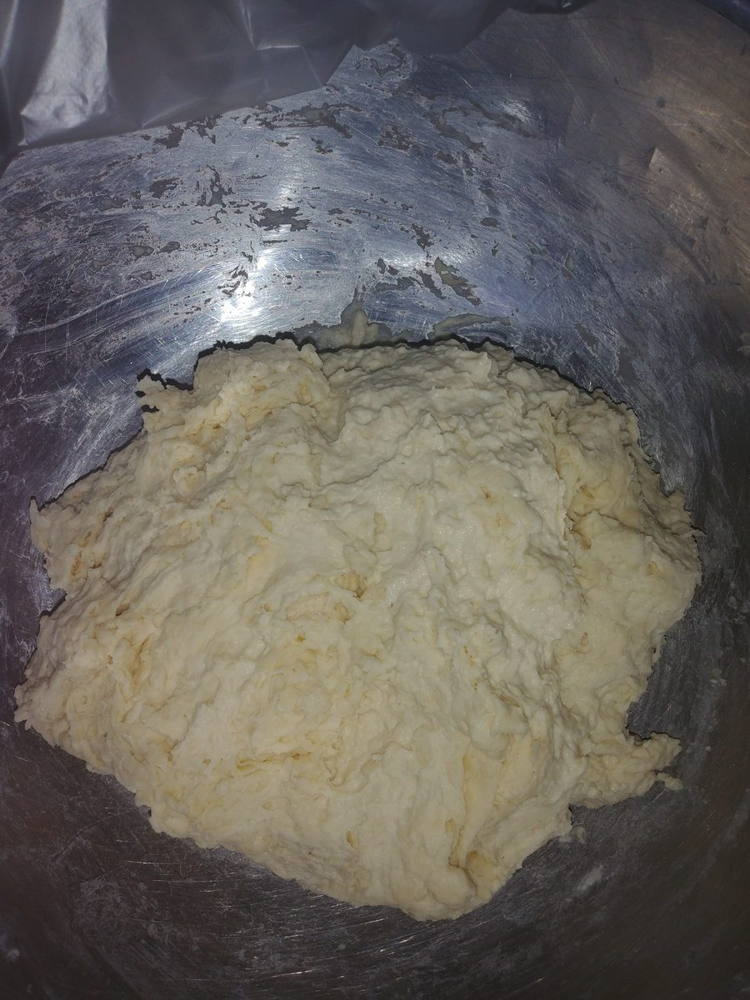
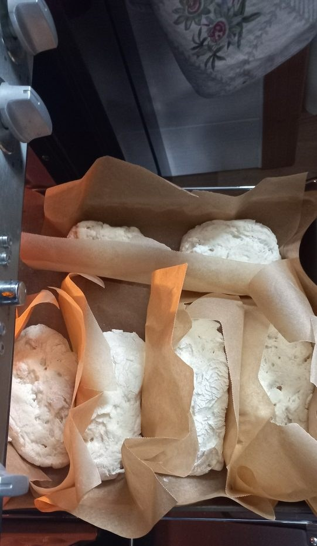
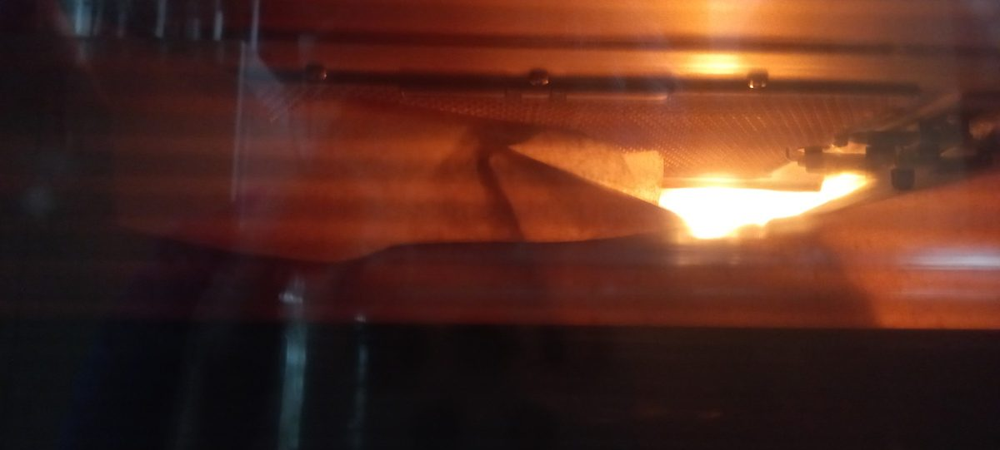
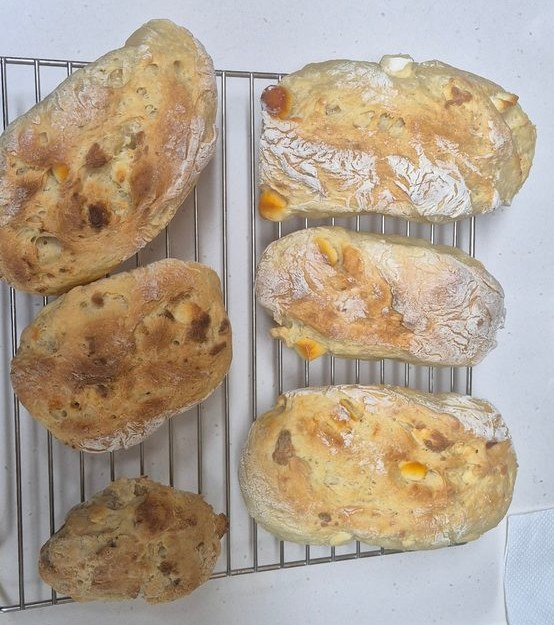

드디어 빵을 구웠습니다. 정확히는 프란이 굽고 저는 구경했어요.

레시피는 검색해서 찾은 그릭 요거트 치아바타예요. 프란은 유튜브 영상으로 만드는 법도 확인했대요. 2배 분량으로 했는데, 그릭 요거트는 312g을 넣었습니다. 2배 분량대로라면 160g이거든요. 대신 요거트가 늘어난 만큼 물을 줄였어요. 물 320g에 요거트 160g, 합쳐서 480g이니까 물은 480g에서 312g을 뺀 168g만 넣었죠. 꿀도 30g 넣었고요.

{: .align-center style="width: 100%; max-width: 420px"}

치대지 않는 빵이에요. 물과 요거트에 가루를 넣고 가루가 날리지 않을 정도로만 섞었어요. 그런데 잘 안 섞이는 것 같아서 물을 더 넣었습니다. 반죽이 노르스름한 건 그릭 요거트와 올리브유 색이에요.

비닐을 씌워 40분 휴지. 그 뒤로는 반죽을 세 번 접고 30분 쉬기를 세 번 했어요. 1차 발효는 잘됐어요. 처음 반죽의 2배 정도로 부풀었거든요. 그런데 세 번째 접기를 하고 나서 더 부풀리고 싶은 욕심에 찜기로 온도를 올려 주다가, 온도 조절을 못 해서 아래쪽 반죽이 살짝 익어 버렸습니다 ㅎㅎ

{: .align-center style="width: 100%; max-width: 420px"}

성형하고 2차 발효는 오븐에서 했어요. 45도에서 40분, 50도에서 20분.

200도로 예열하고 18분 구운 뒤, 14분을 더 구웠어요. 합쳐서 32분.

갓 구운 빵은 겉이 바삭하고 속은 폭신했어요. 달지 않고, 요거트를 많이 넣어서 그런지 약간 시큼합니다. 아래쪽 익어 버린 반죽도 버리지 않고 구웠는데, 이건 스콘처럼 됐어요.

치아바타 레시피였지만, 제가 보기엔 완성된 빵은 치아바타 느낌은 아니었어요. 프란은 치아바타 느낌 난다고 반박했지만요 ㅎㅎ 다음에는 레시피대로 정량을 맞춰서 해 보고 싶어요.

| 재료 | 넣은 양 |
| --- | --- |
| 강력분 | 600g |
| 그릭 요거트 | 312g |
| 물 | 168g + 섞으며 조금 더 |
| 드라이 이스트 | 8g |
| 소금 | 10g |
| 올리브유 | 30g |
| 꿀 | 30g |

- 섞기: 치대지 않고 가루가 날리지 않을 정도로만
- 휴지 40분 → (세 번 접기 + 30분 휴지) × 3 = 1차 발효, 2배 정도 부풂 (그 뒤 찜기로 더 데우다 아래쪽이 살짝 익음)
- 성형 → 2차 발효: 오븐 45도 40분 + 50도 20분
- 굽기: 200도 예열, 18분 + 14분 = 32분
