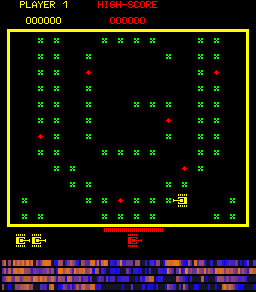
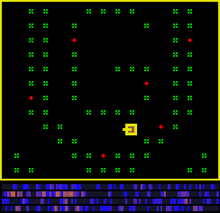

시작은 이랬습니다.

MAME 게임을 블로그에 올려볼까? 올리는 건 가능한데 게임 롬 저작권이 걸리더군요. 저작권이 오픈된 게임이 몇 개 있었는데, 그중 Super Tank라는 게임이 있더군요. 1981년 독일에서 나온 탱크 게임이에요.

잘되긴 하는데 조작도 힘들고 자꾸 죽더라구요. 게임도 대신 시켜 보자 생각이 들었습니다.

그래서 대신맨에게 신경망으로 Super Tank를 대신 하게 했습니다. 처음엔 랜덤보다 못하더니 학습할수록 제법 그럴싸하게 게임을 하더라구요. 그러다 문득 초파리로 둠 게임을 진행했다는 유툽 영상 본 기억이 떠올랐어요. 그때 호기심이 발동하여 초파리 뇌지도 테스트 해봤는데 너무 느려 그렇구나 정도로 지나갔습니다. 이 게임을 가벼운 예쁜꼬마선충에게 대신하게 하는건 어떨까 하는 생각이 들었습니다.

## 꼬마선충의 뇌 지도

예쁜꼬마선충(C. elegans)은 1mm짜리 벌레인데, 뉴런 302개의 연결이 처음으로 전부 밝혀진 동물입니다. 오픈소스 프로젝트 OpenWorm이 정리한 연결표를 받아 보니 뉴런 300개에 근육과 기타 세포까지 448개, 연결이 7,378개였어요.

Super Tank는 먹이와 포식자가 있는 환경으로 보였어요. 초록 블록을 먹으며 돌아다니고, 빨간 적 탱크가 쫓아오고, 포탄이 날아오니까요. 꼬마선충의 감각을 게임에 연결했습니다.

- 초록 블록과 빨간 마름모는 먹이 냄새
- 적 탱크는 포식자, 포탄은 포식자의 공격 (몸에 닿는 촉각)
- 노란 테두리 벽은 코에 닿는 느낌

움직임은 꼬마선충의 전진, 후진, 머리를 굽히는 뉴런에 연결하고 이 뉴런이 켜지는 정도를 읽어 방향 버튼을 누르게 했습니다. 총알은 뱉는 데 쓰는 인두 뉴런이 켜질 때 쏘게 했고요.

## 어! 되는구나

게임에 꼬마선충을 연결하고 켰는데 탱크가 움직입니다.

"어! 되는구나"

잘하지는 못했어요. 점수는 0점에서 400점 사이. 그래도 감각만 연결한 꼬마선충의 뇌지도가 게임을 하는 걸 보니 신기했어요.

학습을 시켜 보기로 했습니다. 신경망과 달라서 배선은 그대로 두고 신호의 세기와 뉴런이 얼마나 쉽게 켜질지를 바꾸도록 했어요. 결과가 좋은 모델을 만들고, 골라 반복했습니다.

## 꼬마선충다워지는 과정

어느 정도 학습된 꼬마선충이 움직이는 모습을 관찰해 보니 모양은 탱크인데 움직임은 꼬마선충 같습니다. 직진해서 갈 수 있는데 좌우로 탱크를 움직이며 꿈틀거립니다. 바로 앞에 먹이가 있는데도 좌우로 몸을 틀다가 못 먹기도 합니다. 아마도 먹이가 많아서 후각 신경이 교란되는 것 같았어요.

사방에서 먹이 냄새가 난다면 혼란스러울 만합니다. 진짜 꼬마선충은 냄새의 양이 아니라 냄새가 진해지는지 약해지는지로 먹이를 찾는다고 해서 머리를 흔들도록 바꿨습니다.

학습된 꼬마선충 중 방향을 한 번도 안 트는 꼬마선충도 있었는데, 원인을 분석해 보니 이유가 재밌었어요. 꼬마선충은 옆으로 누워서 기어갑니다. 그래서 방향을 바꿀 때 좌우가 아니라 등과 배 쪽으로 몸을 굽힙니다. 처음엔 왼쪽 뉴런과 오른쪽 뉴런으로 방향을 바꾸게 연결했는데, 꼬마선충의 왼쪽·오른쪽 뉴런은 거울처럼 쌍을 이뤄 늘 똑같이 켜지니 돌 수가 없었던 거죠. 등과 배 뉴런으로 바꾸자 그제야 돌기 시작했습니다.

Super Tank에 대해 모르는 게 많다 생각되어 MAME 공식 설명을 읽어 봤는데 초록 블록은 먹이가 아니라 지뢰였어요. 탱크로 지나가서 치우는 지뢰밭의 지뢰. 슈퍼탱크 세상에서 꼬마선충의 먹이는 지뢰였네요. ㅎㅎㅎ

## 대신맨 신경망과 비교

대신맨의 신경망과 꼬마선충을 비교해 봤습니다. 둘 다 학습 방법은 같아요. 주어지는 데이터는 차이가 있습니다. 그런데 학습 속도는 신경망이 훨씬 빨랐어요. 20세대, 22분 만에 2,300점을 냈거든요. 우리의 꼬마선충은 무작위로 버튼을 누르는 것보다 잘하게 되기까지 몇십 세대와 모델 수정 여러 번이 필요했고요.

신경망은 백지에서 시작했어요. 규칙을 하나도 알려 주지 않았는데, 블록 위를 지나다니면 점수가 오른다는 걸 스스로 찾아냈습니다. 그렇게 게임 세계의 한 부분이 된 거죠. 적 탱크에게 쏘는 건 거의 안 해요.

신경망과 꼬마선충이 받는 정보를 비교해 봤습니다.

| | 대신맨 신경망 | 꼬마선충 |
| --- | --- | --- |
| 기준 | 위에서 본 지도 | 자기 몸 (앞, 뒤, 등쪽, 배쪽) |
| 내 위치 | 정확한 좌표 | 모름 |
| 적 | 가까운 2대의 정확한 방향과 거리 | 어느 쪽에 있는지, 대략 얼마나 가까운지 |
| 먹이 | 코앞 18픽셀 안에 블록(지뢰)이 있는지 | 냄새가 진해지는지 약해지는지 |
| 움직임 | 9방향 바로 선택 | 전진·후진, 90도 꺾기 |

신경망은 사람이 화면을 보고 플레이하는 것과 비슷한 정보를 받아요. 꼬마선충은 화면도 조이스틱도 없이, 탱크가 되어 냄새를 맡고 기어다닙니다. 말 그대로 슈퍼탱크 세계에 환생한 거죠.

신경망에게는 비교적 정확한 정보가 주어집니다. 꼬마선충에게는 감각을 통해 입력되는 정보만 있습니다. 패널티죠. 그래서 처음부터 제가 몇 가지를 정해 줬습니다. 먹이 냄새는 끌리는 뉴런에, 적은 피하는 뉴런에 연결했고, "먹이는 쏘지 말고 정면의 포식자에게만 쏜다"는 규칙도 넣었습니다. 이렇게 쓰고 보니 혼자 아무런 규칙도 모른 채 던져진 신경망과, 보호자가 개입하여 돌봐 준 꼬마선충의 대결이 되었네요.

가장 똑똑한 버전의 신경망과 꼬마선충을 3개의 잔기가 모두 사라질 때까지, 10%는 일부러 손이 미끄러지게 해서 12판씩 진행하도록 한 후 평균을 냈습니다.

- 무작위로 버튼 누르기: 1,771점
- 대신맨 신경망: 1,846점
- 꼬마선충: 2,121점

꼬마선충이 제일 높긴 한데, 12판으로는 차이가 오차 범위 안이에요.

## 꼬마선충의 천국

냄새와 관련된 부분을 고친 뒤에도 탱크는 여전히 꿈틀거렸어요. 확인해 보니 꼬마선충이 머리를 흔들며 냄새 맡는 방식과 뉴런이 지쳤다 회복하는 리듬을 통해 저절로 생긴 움직임이었어요.

문득 포식자가 없으면 꼬마선충이 어떻게 움직일지 궁금해졌어요. 게임 메모리를 고쳐 적을 없애 보려다 잘 안 돼서, 게임판을 그대로 본뜬 놀이터를 따로 만들었습니다. 적은 없고, 먹이를 다 먹으면 판 전체에 먹이가 다시 생겨요.

포식자가 없으니 천국이죠.

먹이만 있는 놀이터는 게임과 달리 빠르게 학습시킬 수 있었어요. 2,639세대를 통해 학습시킨 꼬마선충은 움직임이 확실히 달랐습니다.

슈퍼탱크에서 학습한 꼬마선충을 놀이터에 넣으면 판의 23%만 맴도는데, 놀이터에서 학습한 꼬마선충은 64%를 훑고 다닙니다. 그래도 여전히 꿈틀거리고, 먹이가 일렬로 있어도 쭉 직진하지는 않습니다.

직진을 잘하게 고칠 방법도 몇 가지 떠올랐는데, 그건 꼬마선충을 인위적으로 조정하는 느낌이라 그만뒀어요. 감각은 진짜 꼬마선충에 가깝게 주되, 그걸로 뭘 할지는 꼬마선충에게 맡기기로 했습니다.

포식자 없이 놀이터에서 학습한 꼬마선충을 슈퍼탱크에 넣어 봤는데 1,629점이 나왔어요. 포식자를 한 번도 본 적 없고 대포 한 번 쏘지 않았는데, 무작위로 버튼을 누르는 것과 비슷한 점수예요.

## 그래서 뭘 알 수 있을까

이렇게 학습하는 꼬마선충으로 무엇을 알 수 있을까? 잠시 생각해 봤습니다.

진짜 꼬마선충에 대해 뭔가를 증명하지는 못할 것 같아요. 완전하게 디지털화된 꼬마선충도 아니니까요.

블록 격파 게임을 하는 AI의 시연 영상을 봤을 때가 생각납니다. 어떻게 저렇게 할 수 있지? 나도 하고 싶다 생각했는데, 이제 나도 신경망과 꼬마선충으로 게임을 대신하게 되었네요. 이를 시작으로 몇 가지 떠오르는 아이디어를 시험해 볼 생각입니다.

Super Tank는 2인용도 됩니다. 1P와 2P가 협력 플레이를 할 수 있죠. 어느 정도 학습이 끝나면 두 마리 꼬마선충을 Super Tank에 풀어 놓을 생각입니다. 같은 지뢰밭에서 만나면 협력과 경쟁이라는 구도가 생길 거라 기대하고 있어요.

생물학자도 아닌데 꼬마선충에게 관심을 갖게 될 줄은 몰랐는데, 꼬마선충에 대해 점점 더 궁금해집니다.
